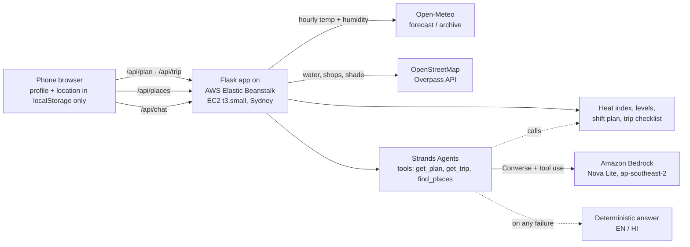

# HeatShift

**An hour-by-hour work and rest plan for outdoor workers on hot days, in English and Hindi.**

HeatShift turns a city's hourly forecast into a schedule for street vendors, delivery riders and construction workers. For each hour of the working day it shows when to work, how many minutes to rest, how often to drink water and when to stop or move into shade. It uses a humidity-adjusted heat index.

It also has four features for the moments when the plan alone is not enough:

- **"I can't avoid this time" safe-trip mode:** risk for a trip at a given time, a job-specific checklist, the nearest safer time, and stop signs.
- **Find water and shade near me:** drinking water, shops selling water or ORS, and shaded or air-conditioned places from OpenStreetMap, with walking times.
- **An AI chat assistant:** a Strands agent on Amazon Bedrock that answers only from HeatShift's own tools.
- **First-visit setup:** job, city, language and optional work hours, saved on the phone. There are no accounts.

- **Live app:** http://heatshift-env.eba-umys9bjc.ap-southeast-2.elasticbeanstalk.com, running on AWS Elastic Beanstalk in ap-southeast-2. It may be switched off after judging; the demo video shows it running.
- **Built for:** WeMakeDevs x AWS "Environmental Hacks", Bharat Builds Tour Event 02, Heat and Water track, 8–11 October 2026.

> Prototype, not medical advice. If someone feels dizzy or confused, stops sweating or faints: move them to shade, give water if they are awake, and call 108.

---

## The problem

India's heat action plans warn people about temperature. They rarely tell an informal worker what to do with their day.

- The Centre for Policy Research reviewed **37 heat action plans** at city, district and state level. It found that **only 10 set locally defined temperature thresholds** and **only 2 assessed who is vulnerable**. [1] *(Verify the exact title and the "2 of 37" figure before submission.)*
- A WIEGO survey of Delhi street vendors in the 2025 heat season found that **89% lack access to free, clean drinking water** at work. [2] *(Verify the exact title and sample size, reported as 519 vendors, before submission.)*

Street vendors, delivery riders and construction workers cannot stay indoors. A forecast that says "44°C" does not tell them whether to take the 1 PM delivery, how long to rest, or when to drink water.

## What changes for a worker

| Before | With HeatShift |
|---|---|
| "Heatwave alert: 44°C" | "Avoid deliveries 12:00–16:00. Rest 20 minutes every hot hour in shade. A glass of water every 20 minutes. Best hours: 05:00–08:00 and 18:00–22:00." |
| The same warning for everyone | Different plans for heavy work (construction), moderate work (riding) and light, stationary work (vending) |
| English text only | English or Hindi, plus a **Listen** button that reads the advice aloud |
| Stays on one phone | A **Share on WhatsApp** button sends the day's plan to a group or co-workers |
| A list of numbers | A **shift plan** that groups the day into blocks (work · work with breaks · stop), plus an interactive temperature chart |
| Nothing for the site supervisor | **Print or save as PDF** turns the plan into a one-page notice for a site or market board |
| No first-aid guidance | **Know the signs:** heat exhaustion vs. heat stroke, and when to call 108, in English and Hindi |
| Temperature only | Heat index (temperature plus humidity), with IMD heat wave rules on top, plus a **"Why this level?"** line |
| "Avoid going out" when you can't | **Safe-trip mode:** "I have to go out at 14:00 for 2 hours" gives the risk, a checklist for your job, the nearest cooler time, and stop signs with 108/112 buttons |
| "Drink water," but where? | **Water and shade near me** from OpenStreetMap: free drinking water, shops for water or ORS, and shaded or AC places, with walking time and a "10-minute break" pick |
| Static advice | **Ask in your own words**, in English or Hindi. The AI answers from today's plan, never inventing temperatures. Emergency words go straight to 108/112 |
| Generic shift | Optional **work hours** highlight the danger hours inside *your* shift |

## Screenshots

| English: delivery rider, 18 Jun 2024 | Hindi: construction worker, 29 May 2024 |
|---|---|
|  |  |

## How it works



1. **Weather.** Hourly temperature and relative humidity for the city come from [Open-Meteo](https://open-meteo.com/), which needs no API key.
   - **Today and upcoming days** use the forecast API.
   - **Replay** loads a real past heatwave day from the historical archive (ERA5 reanalysis). It is not heatwave season in October, so each city lists its own 2024 heatwave days in `cities.json`:
     - **Delhi:** 18 June 2024 (highest heat index of the year) and 29 May 2024 (dry, 46°C).
     - **Ahmedabad:** 27 May 2024 (feels like 48°C) and 23 May 2024 (dry, 46.5°C).
   - If Open-Meteo is unreachable, a bundled copy of the replay day is used and labelled on screen.
2. **Heat index.** Calculated with the NWS heat index equation (Rothfusz regression, NWS Technical Attachment SR 90-23), including the NWS low- and high-humidity adjustments. [3]
3. **Heat level.** See [Heat levels](#heat-levels).
4. **Schedule.** Each worker profile maps the level to rest minutes per hour, a water interval and hours to avoid.
5. **Advice.** A [Strands Agents](https://strandsagents.com/) agent on **Amazon Bedrock** writes a short message in English or Hindi from these numbers only. If Bedrock is off, slow or fails, the app falls back to template text in the same language, so it never breaks.
6. **Safe trip (`/api/trip`).** This is deterministic. It takes the worst level in the trip window and builds a checklist from the job and the level, in English and Hindi. It looks for the nearest window of the same length that has a lower level or feels at least 2°C cooler. It also returns the stop signs. On today's forecast it never suggests an hour that has already passed.
7. **Places (`/api/places`).** A server-side proxy to the OpenStreetMap Overpass API. It identifies itself with a descriptive User-Agent and has an 8 s timeout, with a mirror as a second try. Results are cached in memory for 10 minutes on a ~100 m grid. If Overpass is down, a bundled OpenStreetMap sample of central Delhi is used. Places are grouped as **Drink water** (`amenity=drinking_water`; `fountain` only when `drinking_water=yes`), **Buy water / ORS** (convenience, kiosk, supermarket, pharmacy) and **Sit in shade / AC** (cafe, fast food, place of worship, community centre, mall, bus station).
8. **Chat (`/api/chat`).** A Strands agent with three **tools that call HeatShift's own code**: `get_plan`, `get_trip(start_hour, hours)` and `find_places`. The system prompt keeps it to heat safety for outdoor workers. It must call a tool before giving any number, answers in the user's language in about 6 lines, gives no diagnosis or doses, and always says to call 108/112 for emergency symptoms.
   - **Emergency words** (fainted, confused, not sweating, fits, बेहोश, …) skip the model entirely and return the emergency steps at once.
   - **Limits:** messages up to 500 characters, 10 per minute per IP (in memory only), and a 15 s timeout.
   - **Fallback:** any failure returns the deterministic trip checklist for the time in the message, with `message_source="template"`.

## Heat levels

The cutoffs come from the **NWS Heat Index Chart** categories (US National Weather Service / NOAA). [3] The °F bands are converted to °C. The values are stored per city in [`data/cities.json`](data/cities.json), so each city can use its own locally defined thresholds, which is the gap the CPR review found.

| HeatShift level | NWS chart category | Heat index |
|---|---|---|
| Safe | below Extreme Caution (includes NWS "Caution", 27–32°C) | < 32.2°C (90°F) |
| Caution | Extreme Caution | 32.2–39.4°C (90–103°F) |
| Danger | Danger | 39.4–51.7°C (103–125°F) |
| Extreme danger | Extreme Danger | ≥ 51.7°C (125°F) |

**IMD air-temperature floor.** In dry pre-monsoon heat, the heat index can come out *below* the air temperature: 46°C air at 10% humidity gives a heat index of about 43°C. To avoid under-warning, the India Meteorological Department heat wave rules are applied on top: [4]

- Air temperature **≥ 45°C** forces at least **Danger** (heat wave).
- Air temperature **≥ 47°C** forces **Extreme danger** (severe heat wave).

The final level is whichever is higher: the heat-index level or the IMD floor.

## Worker profiles

These are prototype values. They are loosely based on OSHA/ACGIH work–rest cycles, where heavier work needs more rest, and NIOSH guidance of about one cup of water every 15–20 minutes in heat. They have not been validated in the field. See [`heatshift/profiles.py`](heatshift/profiles.py).

| Profile | Rest min per hour (caution / danger / extreme) | Water every (danger) | Hours to avoid at Danger or above |
|---|---|---|---|
| Construction worker (heavy) | 15 / 30 / 45 | 15 min | 12:00–16:00, stop heavy work |
| Delivery rider (moderate) | 10 / 20 / 40 | 20 min | 12:00–16:00, no deliveries |
| Street vendor (light) | 5 / 15 / 30 | 20 min | 13:00–16:00, move into shade or cover the stall |

Any **Extreme danger** hour is marked "avoid" for every profile.

## Where AWS fits

| AWS piece | What it does here |
|---|---|
| **AWS Elastic Beanstalk** (Python 3.12 on Amazon Linux 2023, ap-southeast-2) | Hosts the Flask app: one single-instance environment, deployed as a ZIP from the CLI ([`deploy.ps1`](deploy.ps1)) |
| **Strands Agents** (AWS open-source agent SDK) | Two agents: one writes the daily advice, and the chat assistant uses **tool calling** (`get_plan`, `get_trip`, `find_places`) to answer from HeatShift's own data |
| **Amazon Bedrock** (`amazon.nova-lite-v1:0`, in-Region in Sydney) | Runs both agents through the Converse API, with tool use, in English and Hindi |
| **IAM** instance role `aws-elasticbeanstalk-ec2-role` | Lets the server call Bedrock without any keys in the code or repo |
| **Amazon S3** | Stores the application versions that Beanstalk deploys |
| **Amazon EC2** | The t3.small instance Beanstalk runs the app on |

HeatShift covers both of the event's AWS paths: **Build It** (Strands Agents, an AWS open-source tool) and **Ship It** (deployed on AWS: Elastic Beanstalk on EC2, with S3 and Bedrock).

The model and region are configuration, not code:

| Environment variable | Default | Meaning |
|---|---|---|
| `BEDROCK_MODEL_ID` | *(unset → template only)* | e.g. `amazon.nova-lite-v1:0` |
| `BEDROCK_REGION` | `ap-southeast-2` | Bedrock region |
| `USE_BEDROCK` | `1` | Set `0` to force template text |
| `BEDROCK_TIMEOUT_S` | `8` | Per-request time limit before falling back |

## Run locally (Windows PowerShell)

```powershell
py -3.12 -m venv .venv
.\.venv\Scripts\Activate.ps1
pip install -r requirements.txt -r requirements-dev.txt
python -m pytest -q
flask --app application run --debug
```

Open http://127.0.0.1:5000. To try the Bedrock message locally, run `aws login --region ap-southeast-2` first, then:

```powershell
$env:BEDROCK_MODEL_ID = "amazon.nova-lite-v1:0"
```

## Deploy

```powershell
.\deploy.ps1 -Label v5
```

The script:
1. Zips the app with its files at the zip root.
2. Uploads the zip to S3.
3. Creates a Beanstalk application version.
4. Updates `heatshift-env`.
5. Waits until the environment is Ready.
6. Checks `/health`.

It stops at the first failing step.

## API

`GET /api/plan?city=delhi&role=rider&lang=en&date=2024-06-18`

| Param | Values |
|---|---|
| `city` | `delhi`, `ahmedabad` |
| `role` | `vendor`, `rider`, `construction` |
| `lang` | `en`, `hi` |
| `date` | `YYYY-MM-DD` (optional; today if empty; past dates replay from the archive; up to 15 days ahead) |

The response includes:
- `hours[]`, each with `time`, `temp_c`, `rh`, `heat_index_c`, `level`, `rest_min`, `water_every_min`, `avoid` and `avoid_action`
- `summary`
- `message` and `message_source` (`bedrock:<model>` or `template`)
- `data_source`, `mode` (`forecast` / `recent` / `replay` / `sample`), `data_fetched_at` and `attribution`

### `GET /api/trip?city=delhi&role=rider&lang=hi&date=2024-06-18&start=14:00&hours=2`

`start` takes `14`, `14:30` or `2pm`; `hours` runs from 0.5 to 12. The response has:
- `risk_level`, `start`, `end`, `max_feels_c`, `window[]`
- `alternative` (`start`, `end`, `shift_hours`, `level`, `text`), or `null`
- `checklist[]` and `stop_signs` (`warning` and `emergency`, each with what to do)
- `sources[]`

### `GET /api/places?lat=28.6304&lon=77.2177&radius=1000`

`radius` is 200–2000 m. The response has:
- `groups.drink[]`, `groups.buy[]` and `groups.shade[]`, each item with `name`, `kind`, `distance_m`, `walk_min`, `osm_url`, `map_url` and `geo_url`
- `break[]`: the 3 closest spots, one of each kind first
- `source` (`openstreetmap` or `sample`) and `attribution`

### `POST /api/chat`

Request body: `{"message": "...", "role": "rider", "city": "delhi", "lang": "en", "date": "2024-06-18", "lat": 28.63, "lon": 77.21}`. `lat` and `lon` are optional.

The response has `answer`, `message_source` (`bedrock:<model>` or `template`) and `tools_used[]`. It also has `fallback_reason` when the template was used, and `emergency: true` for emergency messages.

### Other endpoints

`GET /api/options` lists cities (with coordinates) and roles. `GET /health` returns `ok`. Every text response is sent with `charset=utf-8`.

## Privacy

- **No accounts and no database.** Job, city, language, work hours and location are saved only in the browser's `localStorage`.
- **Location** goes to the server only in the moment you press "Find water / shade near me" or ask the chat, and only to look up places. It is **never logged or stored**. The places cache uses a rounded ~100 m grid and lasts 10 minutes.
- **Chat messages** are not logged. Only the outcome is logged: job, language, AI or template, and the tools used. The rate limiter keeps client IPs in memory for 60 seconds.

## Add a city

Add one entry to [`data/cities.json`](data/cities.json). It needs:
- the city's name in English and Hindi
- latitude and longitude, timezone and UTC offset
- its own `hi_cutoffs_c` and `imd_floor_c`
- `replay_days`

Optionally, save an offline copy of the first replay day in `data/samples/<city>_<date>.json`. No code changes are needed: Ahmedabad was added this way. Its cutoffs are the defaults for now; city teams would replace them with locally calibrated values.

## Project layout

```
application.py        Flask app (Beanstalk looks for `application`)
heatshift/            heat_index, weather, profiles, schedule, messages, advice, cities,
                      trip (safe-trip checklist), places (Overpass proxy), chat (Strands agent + tools)
data/cities.json      per-city location and thresholds
data/samples/         offline copies of the replay days + an OSM sample for central Delhi
templates/, static/   plain HTML + JS frontend, no build step (app.js, trip.js, places.js, chat.js)
tests/                pytest (112 tests): heat index, schedule, API, advice, trip, places (mocked Overpass), chat fallback
deploy.ps1            CLI redeploy to Elastic Beanstalk
docs/                 demo script, writeup, blog draft
```

## Limitations

- Archive data is **ERA5 reanalysis**, a gridded model product, not a weather station. It reads a little lower than station records such as Safdarjung.
- Profile values and thresholds are prototype values. They are not validated with workers or health experts.
- The heat index assumes shade and light wind. Direct sun can add several degrees; this is not modelled yet.
- Two cities so far (Delhi, Ahmedabad), both using default thresholds.

## AI tools used

- **Claude Code** (Anthropic), running inside the **Antigravity** IDE: used for planning, writing code, tests and docs. All output was reviewed, run and tested by me.
- **Amazon Bedrock (Amazon Nova Lite) via Strands Agents**: writes the in-app advice message and powers the chat assistant at runtime.

## Sources

1. Pillai, A. V. & Dalal, T. (2023). *How Is India Adapting to Heatwaves? An Assessment of Heat Action Plans With Insights for Transformative Climate Action.* Centre for Policy Research. https://cprindia.org/wp-content/uploads/2023/03/Heat-Report_Final_27March-23.pdf *(verify exact title and figures before submission)*
2. WIEGO (2026). *Policy Brief 34* on heat stress among Delhi street vendors. https://www.wiego.org/wp-content/uploads/2026/02/WIEGO-Policy-Brief-34.pdf *(verify exact title and sample size before submission)*
3. NOAA / National Weather Service, Weather Prediction Center: The Heat Index Equation. https://www.wpc.ncep.noaa.gov/html/heatindex_equation.shtml. NWS Heat Index Chart: https://www.weather.gov/safety/heat-index
4. India Meteorological Department: heat wave criteria. https://mausam.imd.gov.in/
5. NCDC, Ministry of Health and Family Welfare: *Public Health Advisory: Extreme Heat/Heatwave*. It says to remind workers to drink a cup of water every 20 minutes, and to provide shade and rest breaks. https://ncdc.mohfw.gov.in/uploads/pdf/5.%20Public%20Health%20Advisory_Extreme%20HeatHeatwave.pdf
6. NDMA: *Heat wave do's and don'ts*. It recommends ORS and homemade drinks (lassi, lemon water, buttermilk) and avoiding alcohol, tea, coffee and carbonated drinks. It also advises light cotton clothes, a damp cloth on the head and neck, and never leaving anyone in a parked vehicle. https://ndma.gov.in/Natural-Hazards/Heat-Wave/Dos-Donts
7. WIEGO (2025): *Working under heat: A practical guide for workers in Delhi.* https://www.wiego.org/wp-content/uploads/2025/10/Working-under-heat22-A-practical-guide-for-workers-in-Delhi.pdf

The safe-trip checklist (`heatshift/trip.py`) follows sources 5–7. One item is not from the Indian advisories: drinking **300–500 ml in the hour before** heat exposure, which is general occupational and sports-medicine pre-hydration guidance. It is labelled as such in the code.

**Weather data by [Open-Meteo.com](https://open-meteo.com/) ([CC BY 4.0](https://creativecommons.org/licenses/by/4.0/)).** **Places and map tiles © [OpenStreetMap contributors](https://www.openstreetmap.org/copyright) (ODbL).**

## Third-party credits

Everything in this repo was written during the event (8–11 October 2026). It builds on these open-source projects and data:

| Used | License |
|---|---|
| [Open-Meteo](https://open-meteo.com/) weather API (forecast + historical archive) | Data: CC BY 4.0 |
| [Flask](https://flask.palletsprojects.com/), [Requests](https://requests.readthedocs.io/), [gunicorn](https://gunicorn.org/) | BSD-3-Clause / Apache-2.0 / MIT |
| [Strands Agents SDK](https://github.com/strands-agents/sdk-python), [boto3](https://github.com/boto/boto3) | Apache-2.0 |
| [IBM Plex Sans, Sans Devanagari, Mono](https://github.com/IBM/plex) via Google Fonts | SIL Open Font License 1.1 |
| [OpenStreetMap](https://www.openstreetmap.org/copyright) data via the [Overpass API](https://overpass-api.de/), and OSM map tiles | Data: ODbL; tiles per the OSM tile usage policy |
| [Leaflet](https://leafletjs.com/) 1.9.4 (loaded from unpkg only when the map is shown) | BSD-2-Clause |
| NWS heat index equation, NWS Heat Index Chart, IMD heat wave criteria | Public methods, cited in [Sources](#sources) |

## License

MIT. See [LICENSE](LICENSE).
