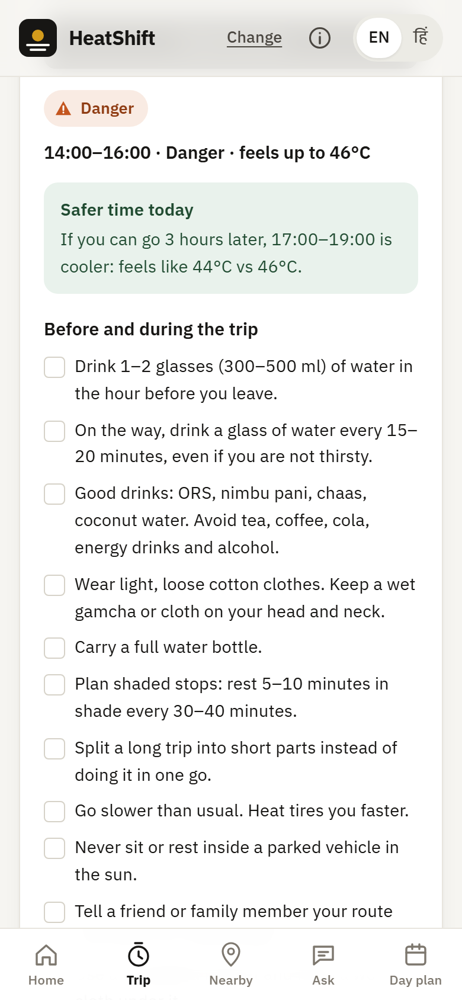
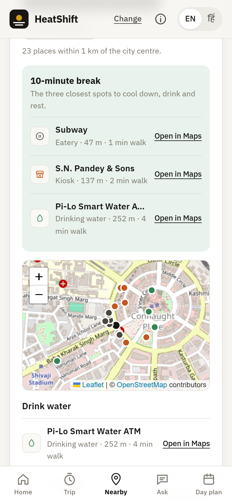
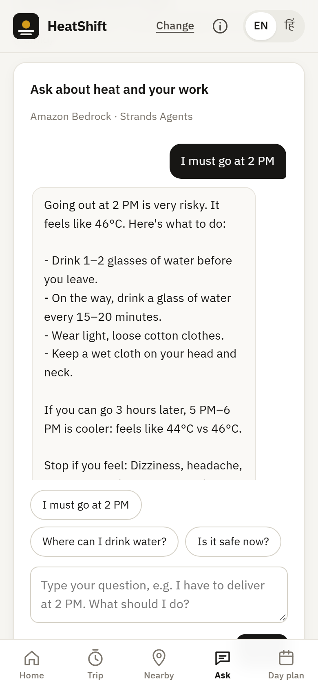
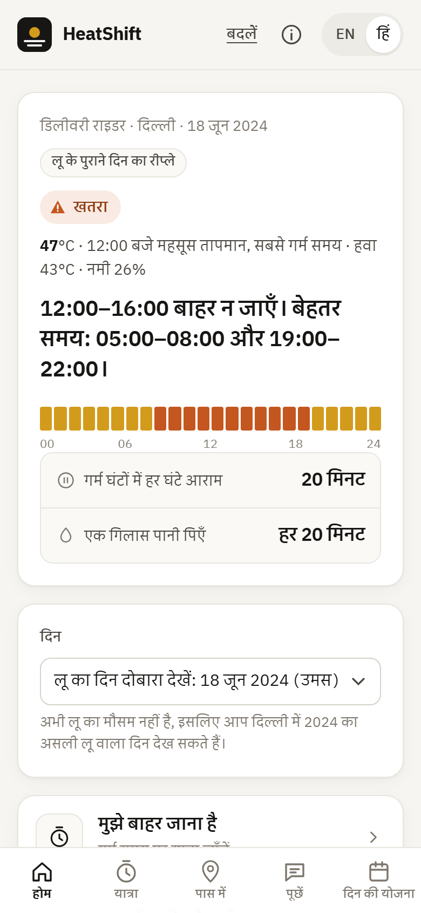
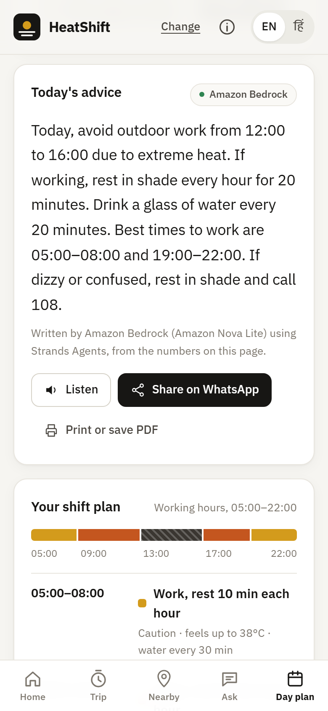
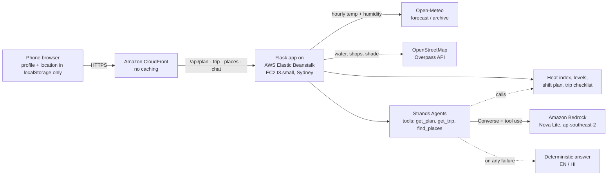

# HeatShift

**Hour-by-hour heat work plans for India's outdoor workers: when to work, rest, drink water or stay out of the sun, in English and Hindi.**

[Live demo](https://d2rsnmdxkrj7b8.cloudfront.net) · [Demo video](https://youtu.be/TatXWYDK8GY) · [Writeup](docs/writeup.md)

> Prototype, not medical advice. In an emergency call **108** (ambulance) or **112**.

## Problem

India's heat action plans warn about temperature but rarely tell a street vendor, delivery rider or construction worker what to do hour by hour. A review of 37 Indian heat action plans found only 10 set locally defined temperature thresholds, and only 2 assessed who is vulnerable [[1]](#sources-and-credits). In a WIEGO survey of around 500 Delhi street vendors in 2025, 89% had no access to free, clean drinking water while working [[2]](#sources-and-credits).

## What it does

- **Hour plan by job:** a work, rest and water schedule for vendors, riders and construction workers, in English and Hindi.
- **Safe-trip mode:** "I have to go out at 2 PM for 2 hours" gives the risk, a job-specific checklist, the nearest cooler time and the 108/112 stop signs.
- **Water and shade near me:** drinking water, shops selling water or ORS, and shaded or AC places from OpenStreetMap, with walking times.
- **AI assistant:** ask in your own words. A Strands agent on Amazon Bedrock answers only from HeatShift's own data.
- **Day plan:** shift blocks, an hourly chart, read-aloud, WhatsApp share and a printable poster for the site or stall.

## Screenshots

<table>
  <tr>
    <td align="center"><br><sub>Home: today's verdict</sub></td>
    <td align="center"><br><sub>Safe trip at 14:00</sub></td>
    <td align="center"><br><sub>Water and shade nearby</sub></td>
  </tr>
  <tr>
    <td align="center"><br><sub>AI answer (Amazon Bedrock)</sub></td>
    <td align="center"><br><sub>Full Hindi interface</sub></td>
    <td align="center"><br><sub>Day plan with share and poster</sub></td>
  </tr>
</table>

## Architecture



| AWS piece | Role |
|---|---|
| **CloudFront** | HTTPS front door, needed for phone location; caching off, all methods forwarded |
| **Elastic Beanstalk** (Python 3.12, AL2023, ap-southeast-2) | Hosts the Flask app; deployed by CLI with `deploy.ps1` |
| **Strands Agents** (AWS open source) | Daily-advice agent, and a chat agent that calls our plan, trip and places tools |
| **Amazon Bedrock**, Nova Lite (in-Region, Sydney) | Runs both agents, in English and Hindi, with a template fallback |
| **IAM** role `aws-elasticbeanstalk-ec2-role` | Lets the server call Bedrock with no keys in the code |
| **Amazon S3** | Stores the application versions |
| **Amazon EC2** | The t3.small instance running the app |

HeatShift covers both event paths: **Build It** (Strands Agents) and **Ship It** (deployed on Elastic Beanstalk with Bedrock). Details are in [docs/ARCHITECTURE.md](docs/ARCHITECTURE.md) and [docs/API.md](docs/API.md).

## How the level is computed

1. The NWS heat index (Rothfusz equation) is computed from hourly temperature and humidity and reported in °C.
2. Four levels come from the NWS Heat Index Chart bands, stored per city so thresholds can be set locally.
3. IMD heatwave floors apply on top: air ≥ 45°C is at least **Danger**, and air ≥ 47°C is **Extreme**. The higher level wins, so dry 46°C heat is not under-rated.

| Level | Safe | Caution | Danger | Extreme danger |
|---|---|---|---|---|
| Heat index | < 32.2°C | 32.2–39.4°C | 39.4–51.7°C | ≥ 51.7°C |

## Run locally

```powershell
py -3.12 -m venv .venv
.\.venv\Scripts\Activate.ps1
pip install -r requirements.txt -r requirements-dev.txt
python -m pytest -q
flask --app application run --debug
```

## Privacy

- No accounts and no database; job, city and language are saved only in the browser.
- Location is sent only for a nearby search or a chat question, and is never logged or stored.
- Chat messages are not logged; only the outcome is (AI or template).

## Limitations

- Replay data is ERA5 reanalysis, which reads slightly lower than station records such as Safdarjung.
- Rest and water values are prototype guidance, not yet validated with workers or health experts.
- Two cities (Delhi, Ahmedabad) with default thresholds; direct-sun exposure is not modelled.

## AI tools used

**Claude Code** in the **Antigravity** IDE for planning, code, tests and docs, all reviewed and tested by me. **Amazon Bedrock (Nova Lite) via Strands Agents** for the in-app advice and chat at runtime.

## Sources and credits

1. Pillai, A. V. & Dalal, T. (2023). [*How is India adapting to heatwaves? An assessment of heat action plans with insights for transformative climate action*](https://cprindia.org/wp-content/uploads/2023/03/Heat-Report_Final_27March-23.pdf). Centre for Policy Research.
2. WIEGO Delhi street vendor heat study (around 500 vendors in 17 clusters, March and June 2025), reported in [*Mapping heat stress shows Delhi street vendors' precarity*](https://questionofcities.org/mapping-heat-stress-shows-delhi-street-vendors-precarity/), Question of Cities.
3. NOAA/NWS: [Heat index equation](https://www.wpc.ncep.noaa.gov/html/heatindex_equation.shtml) and [heat index chart](https://www.weather.gov/safety/heat-index).
4. India Meteorological Department: [heatwave criteria](https://mausam.imd.gov.in/).
5. NCDC (MoHFW): [Public Health Advisory: Extreme Heat/Heatwave](https://ncdc.mohfw.gov.in/uploads/pdf/5.%20Public%20Health%20Advisory_Extreme%20HeatHeatwave.pdf).
6. NDMA: [Heat wave do's and don'ts](https://ndma.gov.in/Natural-Hazards/Heat-Wave/Dos-Donts).

- Weather data by [Open-Meteo.com](https://open-meteo.com/) ([CC BY 4.0](https://creativecommons.org/licenses/by/4.0/)).
- Places and map tiles © [OpenStreetMap contributors](https://www.openstreetmap.org/copyright) (ODbL), via the Overpass API. Libraries: Flask, Strands Agents, boto3, Leaflet, IBM Plex.

**License:** MIT, see [LICENSE](LICENSE).
