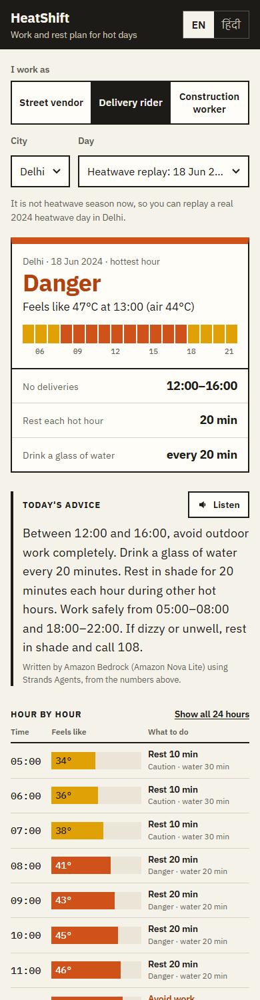
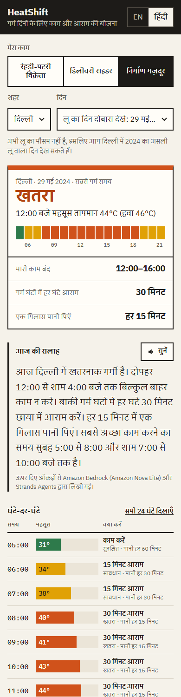
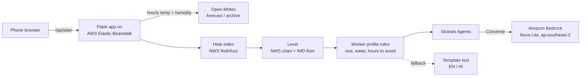

# HeatShift

**An hour-by-hour work and rest plan for outdoor workers on hot days, in English and Hindi.**

HeatShift turns a city's hourly forecast into a schedule for street vendors, delivery riders and construction workers. For each hour of the working day it shows when to work, how many minutes to rest, how often to drink water and when to stop or move into shade. It uses a humidity-adjusted heat index.

- **Live app:** http://heatshift-env.eba-umys9bjc.ap-southeast-2.elasticbeanstalk.com, running on AWS Elastic Beanstalk in ap-southeast-2. It may be switched off after judging; the demo video shows it running.
- **Built for:** WeMakeDevs x AWS "Environmental Hacks", Bharat Builds Tour Event 02, Heat and Water track, 8–11 October 2026.

> Prototype, not medical advice. If someone feels dizzy or confused, stops sweating or faints: move them to shade, give water if they are awake, and call 108.

---

## The problem

India's heat action plans warn people about temperature. They rarely tell an informal worker what to do with their day.

- The Centre for Policy Research reviewed **37 heat action plans** at city, district and state level. It found that **only 10 set locally defined temperature thresholds** and **only 2 assessed who is vulnerable**. [1] *(Verify the exact title and the "2 of 37" figure before submission.)*
- A WIEGO survey of Delhi street vendors in the 2025 heat season found that **89% lack access to free, clean drinking water** at work. [2] *(Verify the exact title and sample size, reported as 519 vendors, before submission.)*

Street vendors, delivery riders and construction workers cannot stay indoors. A forecast that says "44°C" does not tell them whether to take the 1 PM delivery, how long to rest, or when to drink water.

## What changes for a worker

| Before | With HeatShift |
|---|---|
| "Heatwave alert: 44°C" | "Avoid deliveries 12:00–16:00. Rest 20 minutes every hot hour in shade. A glass of water every 20 minutes. Best hours: 05:00–08:00 and 18:00–22:00." |
| The same warning for everyone | Different plans for heavy work (construction), moderate work (riding) and light, stationary work (vending) |
| English text only | English or Hindi, plus a **Listen** button that reads the advice aloud |
| Stays on one phone | A **Share on WhatsApp** button sends the day's plan to a group or co-workers |
| Temperature only | Heat index (temperature plus humidity), with IMD heat wave rules on top |

## Screenshots

| English: delivery rider, 18 Jun 2024 | Hindi: construction worker, 29 May 2024 |
|---|---|
|  |  |

## How it works



1. **Weather.** Hourly temperature and relative humidity for the city come from [Open-Meteo](https://open-meteo.com/), which needs no API key.
   - **Today and upcoming days** use the forecast API.
   - **Replay** loads a real past heatwave day from the historical archive (ERA5 reanalysis). It is not heatwave season in October, so each city lists its own 2024 heatwave days in `cities.json`:
     - **Delhi:** 18 June 2024 (highest heat index of the year) and 29 May 2024 (dry, 46°C).
     - **Ahmedabad:** 27 May 2024 (feels like 48°C) and 23 May 2024 (dry, 46.5°C).
   - If Open-Meteo is unreachable, a bundled copy of the replay day is used and labelled on screen.
2. **Heat index.** Calculated with the NWS heat index equation (Rothfusz regression, NWS Technical Attachment SR 90-23), including the NWS low- and high-humidity adjustments. [3]
3. **Heat level.** See [Heat levels](#heat-levels).
4. **Schedule.** Each worker profile maps the level to rest minutes per hour, a water interval and hours to avoid.
5. **Advice.** A [Strands Agents](https://strandsagents.com/) agent on **Amazon Bedrock** writes a short message in English or Hindi from these numbers only. If Bedrock is off, slow or fails, the app falls back to template text in the same language, so it never breaks.

## Heat levels

The cutoffs come from the **NWS Heat Index Chart** categories (US National Weather Service / NOAA). [3] The °F bands are converted to °C. The values are stored per city in [`data/cities.json`](data/cities.json), so each city can use its own locally defined thresholds, which is the gap the CPR review found.

| HeatShift level | NWS chart category | Heat index |
|---|---|---|
| Safe | below Extreme Caution (includes NWS "Caution", 27–32°C) | < 32.2°C (90°F) |
| Caution | Extreme Caution | 32.2–39.4°C (90–103°F) |
| Danger | Danger | 39.4–51.7°C (103–125°F) |
| Extreme danger | Extreme Danger | ≥ 51.7°C (125°F) |

**IMD air-temperature floor.** In dry pre-monsoon heat, the heat index can come out *below* the air temperature: 46°C air at 10% humidity gives a heat index of about 43°C. To avoid under-warning, the India Meteorological Department heat wave rules are applied on top: [4]

- Air temperature **≥ 45°C** forces at least **Danger** (heat wave).
- Air temperature **≥ 47°C** forces **Extreme danger** (severe heat wave).

The final level is whichever is higher: the heat-index level or the IMD floor.

## Worker profiles

These are prototype values. They are loosely based on OSHA/ACGIH work–rest cycles, where heavier work needs more rest, and NIOSH guidance of about one cup of water every 15–20 minutes in heat. They have not been validated in the field. See [`heatshift/profiles.py`](heatshift/profiles.py).

| Profile | Rest min per hour (caution / danger / extreme) | Water every (danger) | Hours to avoid at Danger or above |
|---|---|---|---|
| Construction worker (heavy) | 15 / 30 / 45 | 15 min | 12:00–16:00, stop heavy work |
| Delivery rider (moderate) | 10 / 20 / 40 | 20 min | 12:00–16:00, no deliveries |
| Street vendor (light) | 5 / 15 / 30 | 20 min | 13:00–16:00, move into shade or cover the stall |

Any **Extreme danger** hour is marked "avoid" for every profile.

## Where AWS fits

| AWS piece | What it does here |
|---|---|
| **AWS Elastic Beanstalk** (Python 3.12 on Amazon Linux 2023, ap-southeast-2) | Hosts the Flask app: one single-instance environment, deployed as a ZIP from the CLI ([`deploy.ps1`](deploy.ps1)) |
| **Strands Agents** (AWS open-source agent SDK) | Builds the advice agent with a system prompt that forbids invented numbers |
| **Amazon Bedrock** (`amazon.nova-lite-v1:0`, in-Region in Sydney) | Writes the English or Hindi advice through the Converse API |
| **IAM** instance role `aws-elasticbeanstalk-ec2-role` | Lets the server call Bedrock without any keys in the code or repo |
| **Amazon S3** | Stores the application versions that Beanstalk deploys |

The model and region are configuration, not code:

| Environment variable | Default | Meaning |
|---|---|---|
| `BEDROCK_MODEL_ID` | *(unset → template only)* | e.g. `amazon.nova-lite-v1:0` |
| `BEDROCK_REGION` | `ap-southeast-2` | Bedrock region |
| `USE_BEDROCK` | `1` | Set `0` to force template text |
| `BEDROCK_TIMEOUT_S` | `8` | Per-request time limit before falling back |

## Run locally (Windows PowerShell)

```powershell
py -3.12 -m venv .venv
.\.venv\Scripts\Activate.ps1
pip install -r requirements.txt -r requirements-dev.txt
python -m pytest -q
flask --app application run --debug
```

Open http://127.0.0.1:5000. To try the Bedrock message locally, run `aws login --region ap-southeast-2` first, then:

```powershell
$env:BEDROCK_MODEL_ID = "amazon.nova-lite-v1:0"
```

## Deploy

```powershell
.\deploy.ps1 -Label v5
```

The script:
1. Zips the app with its files at the zip root.
2. Uploads the zip to S3.
3. Creates a Beanstalk application version.
4. Updates `heatshift-env`.
5. Waits until the environment is Ready.
6. Checks `/health`.

It stops at the first failing step.

## API

`GET /api/plan?city=delhi&role=rider&lang=en&date=2024-06-18`

| Param | Values |
|---|---|
| `city` | `delhi`, `ahmedabad` |
| `role` | `vendor`, `rider`, `construction` |
| `lang` | `en`, `hi` |
| `date` | `YYYY-MM-DD` (optional; today if empty; past dates replay from the archive; up to 15 days ahead) |

The response includes:
- `hours[]`, each with `time`, `temp_c`, `rh`, `heat_index_c`, `level`, `rest_min`, `water_every_min`, `avoid` and `avoid_action`
- `summary`
- `message` and `message_source` (`bedrock:<model>` or `template`)
- `data_source`, `mode` (`forecast` / `recent` / `replay` / `sample`), `data_fetched_at` and `attribution`

`GET /api/options` lists cities and roles. `GET /health` returns `ok`.

## Add a city

Add one entry to [`data/cities.json`](data/cities.json). It needs:
- the city's name in English and Hindi
- latitude and longitude, timezone and UTC offset
- its own `hi_cutoffs_c` and `imd_floor_c`
- `replay_days`

Optionally, save an offline copy of the first replay day in `data/samples/<city>_<date>.json`. No code changes are needed: Ahmedabad was added this way. Its cutoffs are the defaults for now; city teams would replace them with locally calibrated values.

## Project layout

```
application.py        Flask app (Beanstalk looks for `application`)
heatshift/            heat_index, weather, profiles, schedule, messages, advice, cities
data/cities.json      per-city location and thresholds
data/samples/         offline copies of the replay days
templates/, static/   plain HTML + JS frontend, no build step
tests/                pytest: heat index, schedule, API, advice fallback
deploy.ps1            CLI redeploy to Elastic Beanstalk
docs/                 demo script, writeup, blog draft
```

## Limitations

- Archive data is **ERA5 reanalysis**, a gridded model product, not a weather station. It reads a little lower than station records such as Safdarjung.
- Profile values and thresholds are prototype values. They are not validated with workers or health experts.
- The heat index assumes shade and light wind. Direct sun can add several degrees; this is not modelled yet.
- Two cities so far (Delhi, Ahmedabad), both using default thresholds.

## AI tools used

- **Claude Code** (Anthropic), running inside the **Antigravity** IDE: used for planning, writing code, tests and docs. All output was reviewed, run and tested by me.
- **Amazon Bedrock (Amazon Nova Lite) via Strands Agents**: writes the in-app advice message at runtime.

## Sources

1. Pillai, A. V. & Dalal, T. (2023). *How Is India Adapting to Heatwaves? An Assessment of Heat Action Plans With Insights for Transformative Climate Action.* Centre for Policy Research. https://cprindia.org/wp-content/uploads/2023/03/Heat-Report_Final_27March-23.pdf *(verify exact title and figures before submission)*
2. WIEGO (2026). *Policy Brief 34* on heat stress among Delhi street vendors. https://www.wiego.org/wp-content/uploads/2026/02/WIEGO-Policy-Brief-34.pdf *(verify exact title and sample size before submission)*
3. NOAA / National Weather Service, Weather Prediction Center: The Heat Index Equation. https://www.wpc.ncep.noaa.gov/html/heatindex_equation.shtml. NWS Heat Index Chart: https://www.weather.gov/safety/heat-index
4. India Meteorological Department: heat wave criteria. https://mausam.imd.gov.in/

**Weather data by [Open-Meteo.com](https://open-meteo.com/) ([CC BY 4.0](https://creativecommons.org/licenses/by/4.0/)).**

## License

MIT. See [LICENSE](LICENSE).
