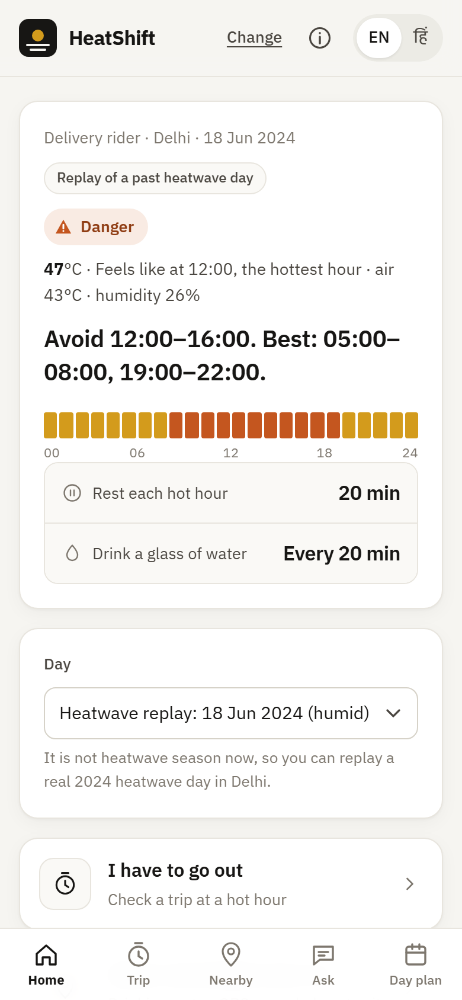

# A heat warning isn't a plan: building HeatShift for India's outdoor workers in 24 hours on AWS

*By Vidhi Singh · WeMakeDevs x AWS Environmental Hacks (Heat and Water track) · October 2026*

**Live app:** http://heatshift-env.eba-umys9bjc.ap-southeast-2.elasticbeanstalk.com · **Code:** https://github.com/vidhisingh24/heatshift · **Demo:** *(YouTube link)*

---

## The problem: "44°C" is not an instruction

On 18 June 2024, Delhi's air temperature reached 44°C, and with the humidity it felt like 47°C. A delivery rider checking the weather that morning saw a number and an orange alert. What they didn't see was an answer to the questions that decide their day:

- Should I take the 1 PM order?
- How long should I rest, and how often?
- How much water, and when?

India's heat action plans are mostly built around warnings. The Centre for Policy Research reviewed 37 of them and found that only 10 set locally defined temperature thresholds, and only 2 assessed who is vulnerable. The most exposed people are informal outdoor workers: street vendors, delivery riders and construction workers. They can't stay indoors and rarely have support at work. In a WIEGO survey of around 500 Delhi street vendors in 2025, 89% had no access to free clean drinking water while working.

So I built **HeatShift**. You pick your city, your work and your language, and it turns the hourly forecast into a **work-and-rest schedule for your job**, in English or Hindi.



## What it does

- A **heat level** for the day (Safe, Caution, Danger, Extreme danger) and the hottest hour.
- Three numbers that matter: **hours to stop** (or, for vendors, to move into shade), **rest minutes per hot hour**, and **how often to drink water**.
- A **shift plan** that groups the working day into blocks (work normally, work with breaks, stop), with an interactive chart of feels-like and air temperature and an hour-by-hour table.
- **Print or save as PDF**, so a contractor can pin the day's plan up at the site.
- **Know the signs:** heat exhaustion vs. heat stroke, and when to call 108.
- A short **advice message** written by an AI agent, plus **Listen** (read aloud) and **Share on WhatsApp**.
- **Replay mode.** It's October, so you can replay real 2024 heatwave days in Delhi and Ahmedabad.

## The stack

| Layer | Choice | Why |
|---|---|---|
| Hosting | **AWS Elastic Beanstalk** (Python 3.12, Amazon Linux 2023, single t3.small, Sydney) | One Flask app as a ZIP: no containers, no build step, health checks for free |
| AI | **Strands Agents SDK** + **Amazon Bedrock** (Amazon Nova Lite) | An open-source agent SDK from AWS; Nova Lite is fast, cheap and good enough at Hindi |
| Weather | **Open-Meteo** forecast + historical archive | No API key; the archive makes the replay of past heatwaves possible |
| Frontend | Plain HTML + JS served by Flask | No build step; loads fast on a cheap phone |
| Tests | pytest (46 tests) | Heat index, levels, schedules, API, AI fallback |

```
Phone ──/api/plan──▶ Flask on Elastic Beanstalk ──▶ Open-Meteo (hourly temp + humidity)
                          │
                          ├─ heat index (NWS Rothfusz) → level (NWS chart + IMD floor)
                          ├─ worker profile → rest / water / hours to avoid
                          └─ Strands Agent → Amazon Bedrock (Nova Lite) ─╳─▶ template text (fallback)
```

### The heat math

The heat index uses the US National Weather Service's Rothfusz regression, including the NWS corrections for very dry and very humid air. Levels come from the bands of the **NWS Heat Index Chart**, converted to °C and stored **per city** in `cities.json`. That last part is deliberate: it is exactly the "locally defined thresholds" gap that CPR found.

### The AI part, and keeping it honest

The model never decides the schedule. HeatShift computes every number first, and the agent only turns those numbers into a few plain sentences:

```python
model = BedrockModel(
    model_id=cfg["model_id"],                       # from env: amazon.nova-lite-v1:0
    boto_session=boto3.Session(region_name=cfg["region"]),
    streaming=False, max_tokens=300, temperature=0.3,
    boto_client_config=botocore.config.Config(
        connect_timeout=3, read_timeout=cfg["timeout_s"], retries={"max_attempts": 1}),
)
agent = Agent(model=model, system_prompt=SYSTEM_PROMPT, callback_handler=None, retry_strategy=None)
text = str(agent(prompt)).strip()
```

The system prompt says: use only the facts given, never invent numbers, describe the level with exactly the word given, keep it under 70 words, and write Hindi in Devanagari. The output is checked before it is shown: there is a length limit, and Hindi replies must actually contain Devanagari.

**The AI is never in the critical path.** Missing package, no model access, a timeout or odd output all lead to the same result: template text in the same language. After a failure, Bedrock is skipped for a minute, so users don't wait 8 seconds on every request.

## What went wrong (and what I learned)

### 1. Dry heat broke my heat index
My first test day was 46°C at 30% humidity, and the heat index came out as **Extreme**. Real Delhi pre-monsoon afternoons sit around 10% humidity, so I tried that: 46°C at 10% gives a heat index of only **about 43°C**, lower than the air temperature. The NWS formula is doing what it should, since dry air helps sweat cool you. But a 46°C day labelled "Danger, feels like 43" would under-warn.

**Fix:** I layered the India Meteorological Department's heat wave rules on top as a floor. Air at **45°C or more** is at least **Danger**, and **47°C or more** is **Extreme danger**. The final level is whichever is higher. Both rules live in `cities.json` next to the NWS cutoffs.

### 2. A brand-new AWS account and Bedrock
My account was created through the new builder experience in Sydney, with no IAM access keys; I sign in with `aws login`. When I tested Bedrock:

- The **`au.` / `apac.` / `global.` cross-Region inference profiles** all failed with *"Your account is currently being verified"*.
- **Anthropic models** later failed with *"Model use case details have not been submitted"*. They need a one-time form.
- **`amazon.nova-lite-v1:0`, in-Region in Sydney**, worked straight away.

To find what works in a region, these are the two commands to run:

```powershell
aws bedrock list-inference-profiles --region ap-southeast-2 --query "inferenceProfileSummaries[].inferenceProfileId"
aws bedrock list-foundation-models --region ap-southeast-2 --by-inference-type ON_DEMAND --query "modelSummaries[].modelId"
```

**Lesson:** put the model ID in an environment variable from day one. Switching models is now a config change, not a code change.

### 3. `aws login` and boto3 on my laptop
Locally, Strands failed with *"Using the login credential provider requires an additional dependency"*. boto3 needs `botocore[crt]` to read `aws login` credentials. It is a dev-only dependency, because the Beanstalk server uses its **IAM instance role** and holds no keys at all. Later, a refresh of those credentials failed with *NoRegionError* even though I had passed `region_name`. Passing a `boto3.Session(region_name=...)` instead fixed it.

### 4. The Beanstalk console said "security token invalid"
The console kept rejecting my session, so I moved deploys to the CLI with a 60-line PowerShell script:

1. Zip the app, with its files at the zip root.
2. `aws s3 cp` it to the deployment bucket.
3. `create-application-version`
4. `update-environment`
5. Poll `describe-environments` until the environment is `Ready`, and confirm it is running the new version.
6. Check `/health`.

The script stops at the first non-zero exit. Two Windows gotchas came up:

- `tar -a -c -f app.zip ...` (built into Windows) writes `/` paths, which Beanstalk accepts.
- Git on Windows wanted to turn my `Procfile` into CRLF, and a `\r` at the end of `application:application` can break gunicorn on Linux. One line in `.gitattributes` fixes it: `* text=auto eol=lf`.

### 5. The model blended two rules
For a construction worker, Nova first wrote "rest 30 minutes every hour from 12 to 4", mixing the **stop-work window** with the **rest rule**. I rewrote the facts I pass to the agent so the difference is explicit: "12:00–16:00: stop outdoor work completely (no work at all)" and "Other hot hours: work, but rest 30 minutes every hour". The next output was correct.

### 6. Headless screenshots lied to me
To check the mobile layout I used headless Edge at 390px. The page looked broken, cut off on the right. In fact headless Chromium has a minimum window width of about 500px. Rendering the page inside a 390px **iframe** gave a true phone viewport, and the layout was fine.

## Design choices for someone outside the team

- **Light, high-contrast "printed notice" look**, because it's used outdoors in bright sun. Colour appears only on the heat scale and always comes with a text label.
- **Big tap targets**, Hindi throughout (IBM Plex Sans Devanagari), read-aloud for low-literacy users, and WhatsApp share because that's how this information actually travels.
- **Honesty on screen:** the data source, the update time, "replay of a past day" when it is one, and "prototype, not medical advice" with the 108 emergency number.

## Cost

A single-instance Beanstalk environment (t3.small, no load balancer) costs about **$0.80 a day** in Sydney, all covered by the AWS Free plan credits. Bedrock Nova Lite costs a fraction of a cent per message, and messages are cached per city, job, language and day.

## What's next

1. Local thresholds per city, calibrated with health departments. The structure is already there.
2. A morning plan sent by **SMS, WhatsApp or IVR** for workers without smartphones.
3. An **employer and contractor view**, so a site supervisor sees the same stop window as the worker.
4. A correction for direct sun, and maps of water points and shade.

If you're building for heat in India, a temperature warning is the start of the conversation, not the end. The useful product is the plan.

---

*Built with Claude Code (inside the Antigravity IDE) for planning and coding, with every line reviewed and tested. In-app advice comes from Amazon Bedrock (Nova Lite) via Strands Agents. Weather data by Open-Meteo.com (CC BY 4.0).*
